# লেসন ০২: লিনিয়ার কম্বিনেশন, স্প্যান এবং বেসিস ভেক্টর (Linear Combinations, Span, and Basis Vectors)
**কোর্স:** Essence of Linear Algebra — 3Blue1Brown (Chapter 2)  
**অনুবাদ ও বিশ্লেষণ:** বাংলা রিসোর্স ফ্যাক্টরি (BRF)  
**বিভাগ:** স্টেম অ্যান্ড গণিত বিভাগ  
**সম্পাদনা ও তত্ত্বাবধান:** স্টুডিও ডিরেক্টর (CEO)  

---

> *"Mathematics requires a small dose, not of genius, but of an imaginative freedom which, in a larger dose, would be insanity."*  
> — **অ্যাঙ্গাস কে. রজার্স (Angus K. Rodgers)**

---

## ১. ভূমিকা: স্থানাঙ্ক (Coordinates) পুনর্বিবেচনা

প্রথম লেসনে আমরা দেখেছি যে কীভাবে ভেক্টর যোগ (Vector Addition) এবং স্কেলার গুণন (Scalar Multiplication)-এর মাধ্যমে সংখ্যার জোড়া এবং দ্বিমাত্রিক তীরের মধ্যে একটি সরাসরি সম্পর্ক তৈরি হয়। 

সাধারণত যখন আমরা কোনো ভেক্টরের স্থানাঙ্ক লিখি, যেমন:
$$
\vec{v} = \begin{bmatrix} 3 \\ -2 \end{bmatrix}
$$

লিনিয়ার বীজগণিতে একে দেখার এক অনন্য ও গভীর জ্যামিতিক দৃষ্টিভঙ্গি রয়েছে। এখানে প্রতিটি স্থানাঙ্ককে একটি **স্কেলার (Scalar)** হিসেবে ভাবা যায়—যা ভেক্টরকে বড় (Stretch) বা ছোট (Squish) করে।

```
                       y-অক্ষ
                         ▲
                         │       ĵ (j-hat) = [0, 1]ᵀ
                         │   ▲
                         │   │
                         └───┼──────────► î (i-hat) = [1, 0]ᵀ
                         │   │               x-অক্ষ
                         │   │
                         ▼   ▼
               v = 3î - 2ĵ = [3, -2]ᵀ
```

### স্ট্যান্ডার্ড একক ভেক্টর (Standard Unit Vectors)
স্থানাঙ্ক ব্যবস্থায় দুটি বিশেষ একক ভেক্টর বিদ্যমান:
1. **$\hat{\imath}$ ("i-hat"):** $x$-অক্ষ বরাবর ধনাত্মক দিকে নির্দেশকারী $1$ একক দৈর্ঘ্যের ভেক্টর:
   $$
   \hat{\imath} = \begin{bmatrix} 1 \\ 0 \end{bmatrix}
   $$
2. **$\hat{\jmath}$ ("j-hat"):** $y$-অক্ষ বরাবর সোজা উপরের দিকে নির্দেশকারী $1$ একক দৈর্ঘ্যের ভেক্টর:
   $$
   \hat{\jmath} = \begin{bmatrix} 0 \\ 1 \end{bmatrix}
   $$

যখন আমরা $\begin{bmatrix} 3 \\ -2 \end{bmatrix}$ লিখি, তখন মূলত:
- $x$-স্থানাঙ্ক ($3$) স্কেলার হিসেবে $\hat{\imath}$-কে ৩ গুণ প্রসারিত করে: $3\hat{\imath}$।
- $y$-স্থানাঙ্ক ($-2$) স্কেলার হিসেবে $\hat{\jmath}$-কে উল্টে দিয়ে দ্বিগুণ করে: $-2\hat{\jmath}$।
- এই দুটি স্কেলড ভেক্টরের ভেক্টর যোগফলই হলো মূল ভেক্টর:
  $$
  \vec{v} = 3\hat{\imath} + (-2)\hat{\jmath} = 3\begin{bmatrix} 1 \\ 0 \end{bmatrix} + (-2)\begin{bmatrix} 0 \\ 1 \end{bmatrix} = \begin{bmatrix} 3 \\ -2 \end{bmatrix}
  $$

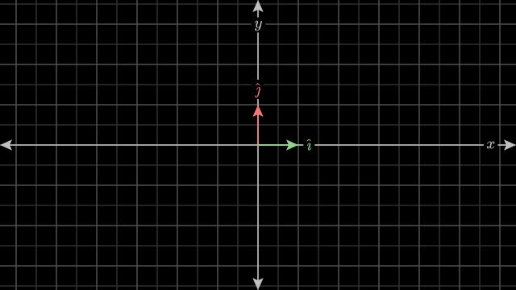

---

## ২. বেসিস ভেক্টর (Basis Vectors) কী?

ভেক্টরদ্বয় $\hat{\imath}$ এবং $\hat{\jmath}$-কে বলা হয় স্থানাঙ্ক ব্যবস্থার **"বেসিস" (Basis)**। 

> 📌 **মূল ধারণা (Concept of Basis):**  
> যখন আমরা স্থানাঙ্ককে স্কেলার হিসেবে ভাবি, তখন সেই স্কেলারগুলো বাস্তবে যে ভেক্টরগুলোকে স্কেল করে, তারাই হলো **বেসিস ভেক্টর**।

আমরা যদি $\hat{\imath}$ এবং $\hat{\jmath}$-এর বদলে সম্পূর্ণ ভিন্ন দুটি ভেক্টর নির্বাচন করি, তাহলেও কি একটি নতুন স্থানাঙ্ক ব্যবস্থা তৈরি করা সম্ভব?  
**হ্যাঁ, অবশ্যই সম্ভব!**

ধরা যাক, আমরা দুটি নতুন ভেক্টর নিলাম $\vec{v}_1$ (ডান-উপরে নির্দেশক) এবং $\vec{v}_2$ (ডান-নিচে নির্দেশক):

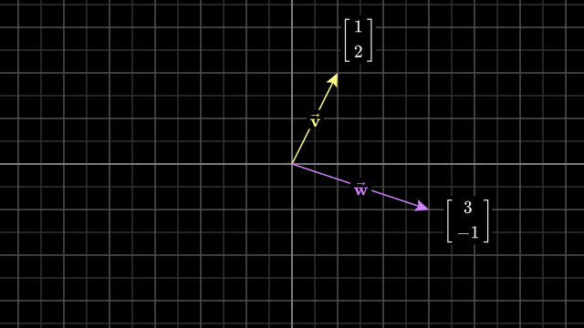

এখন যেকোনো বাস্তব সংখ্যাজোড় $(c_1, c_2)$ দিয়ে যদি আমরা এদের স্কেল করে যোগ করি:
$$
\vec{u} = c_1 \vec{v}_1 + c_2 \vec{v}_2
$$
তাহলে দেখা যাবে আমরা পুরো দ্বিমাত্রিক তলের **যেকোনো বিন্দুতেই** পৌঁছাতে পারি! 

তবে মনে রাখতে হবে, নতুন বেসিসের অধীনে কোনো বিন্দুর স্থানাঙ্ক এবং প্রমিত ($\hat{\imath}, \hat{\jmath}$) বেসিসের স্থানাঙ্ক সংখ্যাগতভাবে এক হবে না:
$$
\begin{bmatrix} -0.8 \\ 1.3 \end{bmatrix}_{\text{new}} \neq \begin{bmatrix} 3.1 \\ -2.9 \end{bmatrix}_{\text{standard}}
$$

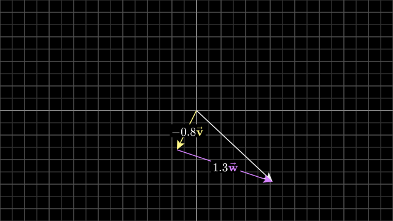

---

## ৩. লিনিয়ার কম্বিনেশন (Linear Combination)

> 💡 **গাণিতিক সংজ্ঞা:**  
> দুটি ভেক্টর $\vec{v}$ এবং $\vec{w}$-কে স্কেলার $a$ ও $b$ দিয়ে গুণ করে পরস্পরের সাথে যোগ করার প্রক্রিয়াকেই বলা হয় তাদের **লিনিয়ার কম্বিনেশন (Linear Combination)**:
> $$
> a\vec{v} + b\vec{w}
> $$
> $n$-সংখ্যক ভেক্টরের ক্ষেত্রে সাধারণ রূপ:
> $$
> c_1\vec{v}_1 + c_2\vec{v}_2 + \dots + c_n\vec{v}_n = \sum_{i=1}^n c_i \vec{v}_i
> $$

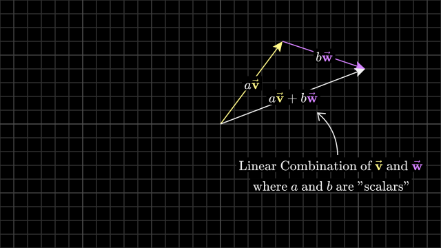

### নামটিতে "Linear" (রৈখিক) কেন?
কোনো ভেক্টর $\vec{v}$-কে যখন সমস্ত বাস্তব স্কেলার $c \in \mathbb{R}$ দিয়ে গুণ করা হয়, তখন তা মূলবিন্দুগামী একটি অসীম সরলরেখা (Line) তৈরি করে।  
দুটি ভেক্টরের লিনিয়ার কম্বিনেশন মূলত এই দুটি সরলরেখাকে পরস্পরের সাপেক্ষে যুক্ত করে নতুন নতুন বিন্দু ও ভেক্টর তৈরি করার একটি সুশৃঙ্খল জ্যামিতিক পদ্ধতি।

---

## ৪. স্প্যান (Span): ভেক্টরের নাগাল

> 🎯 **স্প্যানের সংজ্ঞা (Definition of Span):**  
> প্রদত্ত একগুচ্ছ ভেক্টরের সমস্ত সম্ভাব্য লিনিয়ার কম্বিনেশন দ্বারা গঠিত সেটের নামই হলো সেই ভেক্টরগুলোর **স্প্যান (Span)**:
> $$
> \text{Span}(\vec{v}_1, \vec{v}_2, \dots, \vec{v}_k) = \left\{ \sum_{i=1}^k c_i \vec{v}_i \;\middle|\; c_i \in \mathbb{R} \right\}
> $$

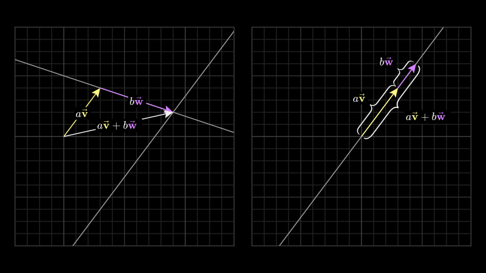

দ্বিমাত্রিক স্থানে ($2\text{D}$) দুটি ভেক্টরের স্প্যান মূলত তিনটি ভিন্ন রূপ নিতে পারে:

| পরিস্থিতি | জ্যামিতিক রূপ | মাত্রা (Dimension) |
| :--- | :--- | :--- |
| ১. ভেক্টর দুটি ভিন্ন দিকে নির্দেশ করে | **সম্পূর্ণ ২ডি তল ($\mathbb{R}^2$ Plane)** | $2$ মাত্রা |
| ২. ভেক্টর দুটি পরস্পর সমরেখ (Collinear / Line up) | **মূলবিন্দুগামী একটি একক সরলরেখা (Line)** | $1$ মাত্রা |
| ৩. উভয় ভেক্টরই শূন্য ভেক্টর ($\vec{0}$) | **শুধুমাত্র মূলবিন্দু (Origin Point)** | $0$ মাত্রা |

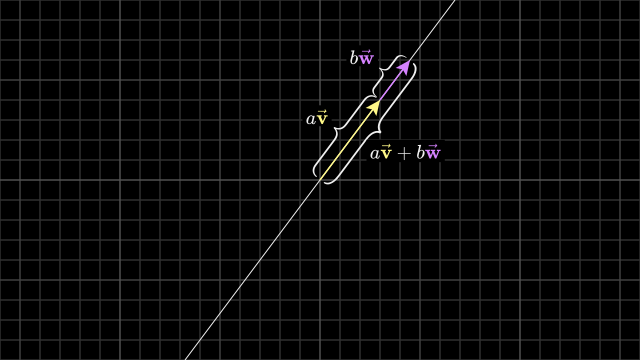

---

## ৫. তীর বনাম বিন্দু (Vectors vs Points)

যখন আমরা অসীম সংখ্যক ভেক্টর নিয়ে ভাবি, তখন সবগুলো তীরচিহ্ন আঁকলে স্ক্রিন জটলা পাকিয়ে যায়।  
তাই গণিতবিদদের অত্যন্ত কার্যকরী একটি কনভেনশন হলো:
- **একক ভেক্টর:** তীরচিহ্ন (Arrow) হিসেবে কল্পনা করুন।
- **ভেক্টরের সংগ্রহ বা স্প্যান:** প্রতিটি তীরের শীর্ষবিন্দু (Tip)-কে একটি **বিন্দু (Point)** হিসেবে চিহ্নিত করুন।

এর ফলে, একটি রেখা বরাবর সমস্ত ভেক্টরের সমষ্টি হবে স্রেফ একটি **সরলরেখা**। আর পুরো দ্বিমাত্রিক স্থানের সমস্ত ভেক্টরের সমষ্টি হবে অসীম সমতল **চাদর (Infinite Flat Sheet)**।

---

## ৬. ত্রিমাত্রিক স্থানে স্প্যান (Span in 3D Space)

ত্রিমাত্রিক স্থানে ($\mathbb{R}^3$) স্প্যানের ধারণাটি অত্যন্ত চিত্তাকর্ষক:

1. **একটি ভেক্টরের স্প্যান ($\vec{v} \neq \vec{0}$):** ত্রিমাত্রিক স্থানে মূলবিন্দুগামী একটি সরলরেখা।
2. **দুটি ভেক্টরের স্প্যান ($\vec{v}, \vec{w}$ যারা সমরেখ নয়):** ত্রিমাত্রিক স্থানের মধ্য দিয়ে মূলবিন্দুকে ছেদ করে যাওয়া একটি **সমতল চাদর (Flat Sheet / 2D Plane)**।
   
   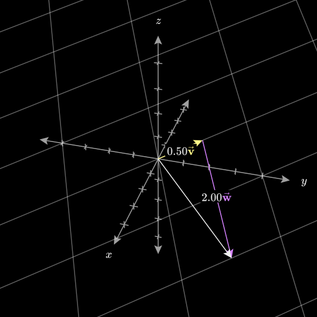

3. **তৃতীয় ভেক্টর $\vec{u}$ যুক্ত করলে কী ঘটবে?**  
   এখানে দুটি চরম সম্ভাবনা রয়েছে:
   
   - **ঘটনা ক (তৃতীয় ভেক্টরটি আগের দুটির সমতলেই অবস্থিত):**  
     $\vec{u}$ ভেক্টরটি $\vec{v}$ এবং $\vec{w}$-এর স্প্যানের ভেতরেই রয়েছে। ফলে নতুন কোনো মাত্রা উন্মুক্ত হয় না। স্প্যান আগের সেই সমতল চাদরেই সীমাবদ্ধ থাকে।
     
     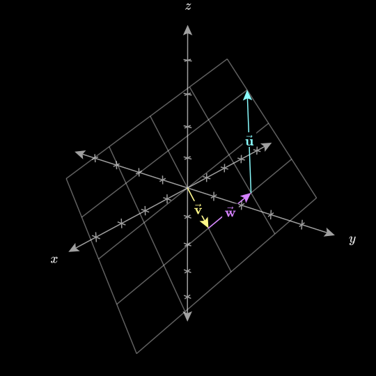
     
   - **ঘটনা খ (তৃতীয় ভেক্টরটি সমতলের বাইরে ভিন্ন দিকে নির্দেশ করে):**  
     এটি সমতলটিকে শূন্যে উপরে-নিচে সুইপ (Sweep) করিয়ে পুরো ত্রিমাত্রিক স্থান ($\mathbb{R}^3$)-এর প্রতিটি বিন্দুতে প্রবেশের দুয়ার খুলে দেয়!
     
     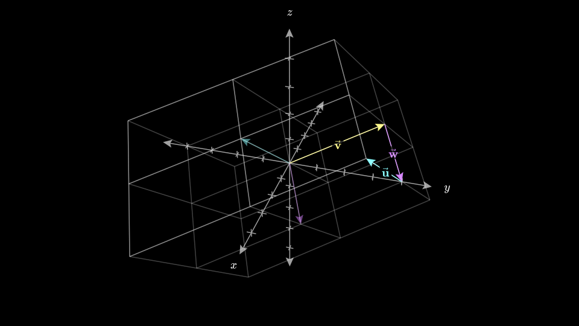

---

## ৭. লিনিয়ার ডিপেনডেন্স বনাম ইনডিপেনডেন্স (Linear Dependence vs Independence)

লিনিয়ার বীজগণিতের অন্যতম স্তম্ভ হলো এই দুটি ধারণা:

### লিনিয়ারলি ডিপেনডেন্ট (Linearly Dependent - রৈখিকভাবে নির্ভরশীল)
যদি একাধিক ভেক্টরের মধ্যে অন্তত একটি ভেক্টর এমন থাকে যা স্প্যানে নতুন কোনো মাত্রা যোগ করে না (অর্থাৎ এটি অতিরিক্ত বা Redundant), তবে ভেক্টরগুলোকে বলা হয় **লিনিয়ারলি ডিপেনডেন্ট**।  
সহজ ভাষায়: যেকোনো একটি ভেক্টরকে বাকি ভেক্টরগুলোর লিনিয়ার কম্বিনেশন হিসেবে প্রকাশ করা যায়:
$$
\vec{u} = c_1\vec{v} + c_2\vec{w}
$$
অথবা সমমানের শর্ত:
$$
a\vec{u} + b\vec{v} + c\vec{w} = \vec{0} \quad (\text{যেখানে সব সহগ শূন্য নয়})
$$

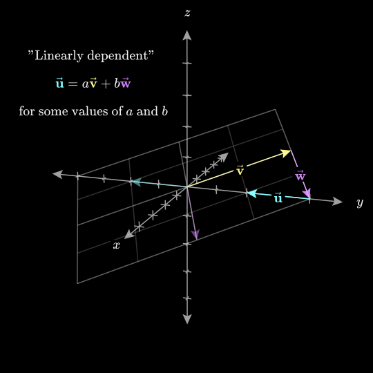

### লিনিয়ারলি ইনডিপেনডেন্ট (Linearly Independent - রৈখিকভাবে স্বাধীন)
যদি প্রতিটি ভেক্টর স্প্যানে একটি করে নতুন ও স্বতন্ত্র মাত্রা (Dimension) যোগ করে, এবং কোনো ভেক্টরকেই বাকিদের কম্বিনেশন হিসেবে তৈরি করা না যায়, তবে তারা **লিনিয়ারলি ইনডিপেনডেন্ট**।
$$
a\vec{v}_1 + b\vec{v}_2 + c\vec{v}_3 = \vec{0} \iff a = b = c = 0
$$

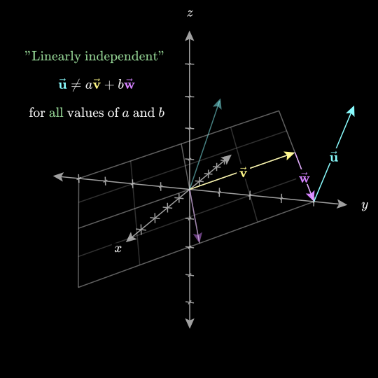

---

## ৮. বেসিসের আনুষ্ঠানিক গাণিতিক সংজ্ঞা (Rigorous Definition of Basis)

এখন আমরা বেসিসের প্রকৃত গাণিতিক সংজ্ঞা বোঝার জন্য প্রস্তুত:

> 🎓 **বেসিস (Basis):**  
> কোনো ভেক্টর স্পেস $V$-এর বেসিস হলো এমন একগুচ্ছ ভেক্টর $\mathcal{B} = \{\vec{v}_1, \vec{v}_2, \dots, \vec{v}_n\}$, যা:
> 1. পরস্পর **লিনিয়ারলি ইনডিপেনডেন্ট (Linearly Independent)**, এবং
> 2. সম্পূর্ণ স্পেসকে **স্প্যান করে (Spans $V$)**।

যদি ভেক্টরগুলো ইনডিপেনডেন্ট না হয়, তবে কিছু ভেক্টর অপ্রয়োজনীয় হয়ে পড়ে। আর যদি তারা পুরো স্পেস স্প্যান না করে, তবে সব বিন্দুতে পৌঁছানো যায় না। এই দুইয়ের নিখুঁত মিলনই হলো বেসিস!

---

## ৯. অনুশীলনী ও বিস্তারিত সমাধান (Interactive Worked Solutions)

### প্রশ্ন ১: সমরেখ ভেক্টর নির্ধারণ
**প্রশ্ন:** নিচের কোন ভেক্টরজোড়টি একক সরলরেখা স্প্যান করবে?
1. $\vec{v} = \begin{bmatrix}2 \\ 3\end{bmatrix}$ এবং $\vec{w} = \begin{bmatrix}-1 \\ -1.5\end{bmatrix}$
2. $\vec{v} = \begin{bmatrix}2 \\ 3\end{bmatrix}$ এবং $\vec{w} = \begin{bmatrix}3 \\ 2\end{bmatrix}$
3. $\vec{v} = \begin{bmatrix}2 \\ 3\end{bmatrix}$ এবং $\vec{w} = \begin{bmatrix}-3 \\ 2\end{bmatrix}$

**উত্তর ও বিশ্লেষণ:**  
১ নং জোড়াটি সঠিক। কারণ:
$$
\vec{w} = \begin{bmatrix}-1 \\ -1.5\end{bmatrix} = -0.5 \begin{bmatrix}2 \\ 3\end{bmatrix} = -0.5\vec{v}
$$
যেহেতু $\vec{w}$ সরাসরি $\vec{v}$-এর স্কেলার গুণিতক, তাই তারা পরস্পর সমরেখ। ফলে তাদের লিনিয়ার কম্বিনেশন $a\vec{v} + b\vec{w} = (a - 0.5b)\vec{v}$ শুধুমাত্র একটি একক সরলরেখা তৈরি করবে।

---

### প্রশ্ন ২: লিনিয়ার সমীকরণ সমাধান করে স্কেলার নির্ণয়
**প্রশ্ন:** চিত্রানুযায়ী $\vec{v} = \begin{bmatrix}2 \\ 3\end{bmatrix}$ এবং $\vec{w} = \begin{bmatrix}-3 \\ 2\end{bmatrix}$ হলে, কোন স্কেলার $a$ ও $b$-এর জন্য লিনিয়ার কম্বিনেশন $\begin{bmatrix}7 \\ 4\end{bmatrix}$ ভেক্টরটি তৈরি করবে?

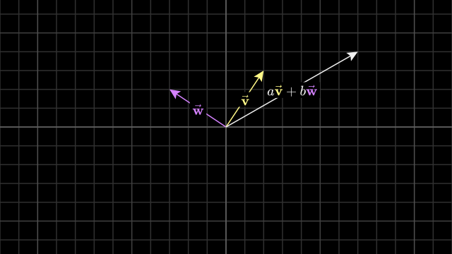

**ধাপভিত্তিক সমাধান:**
লিনিয়ার কম্বিনেশন সমীকরণটি লিখি:
$$
a \begin{bmatrix} 2 \\ 3 \end{bmatrix} + b \begin{bmatrix} -3 \\ 2 \end{bmatrix} = \begin{bmatrix} 7 \\ 4 \end{bmatrix}
$$

উপাদানভিত্তিক সমীকরণ গঠন:
$$
\begin{aligned}
(1) \quad 2a - 3b &= 7 \\
(2) \quad 3a + 2b &= 4
\end{aligned}
$$

সমীকরণ (২) থেকে $b$-এর মান বের করি:
$$
2b = 4 - 3a \implies b = \frac{4 - 3a}{2}
$$

সমীকরণ (১)-এ $b$-এর মান বসিয়ে পাই:
$$
\begin{aligned}
2a - 3\left(\frac{4 - 3a}{2}\right) &= 7 \\
4a - 3(4 - 3a) &= 14 \\
4a - 12 + 9a &= 14 \\
13a &= 26 \implies a = 2
\end{aligned}
$$

এখন $b$-এর মান নির্ণয়:
$$
b = \frac{4 - 3(2)}{2} = \frac{4 - 6}{2} = -1
$$

**চূড়ান্ত ফলাফল:**
$$
a = 2, \quad b = -1
$$
যাচাইকরণ:
$$
2\begin{bmatrix} 2 \\ 3 \end{bmatrix} + (-1)\begin{bmatrix} -3 \\ 2 \end{bmatrix} = \begin{bmatrix} 4 \\ 6 \end{bmatrix} + \begin{bmatrix} 3 \\ -2 \end{bmatrix} = \begin{bmatrix} 7 \\ 4 \end{bmatrix} \quad \text{(প্রমাণিত)}
$$

---
*বাংলা রিসোর্স ফ্যাক্টরি — জ্ঞান হোক সর্বজনীন, প্রাঞ্জল এবং সমৃদ্ধ।*
