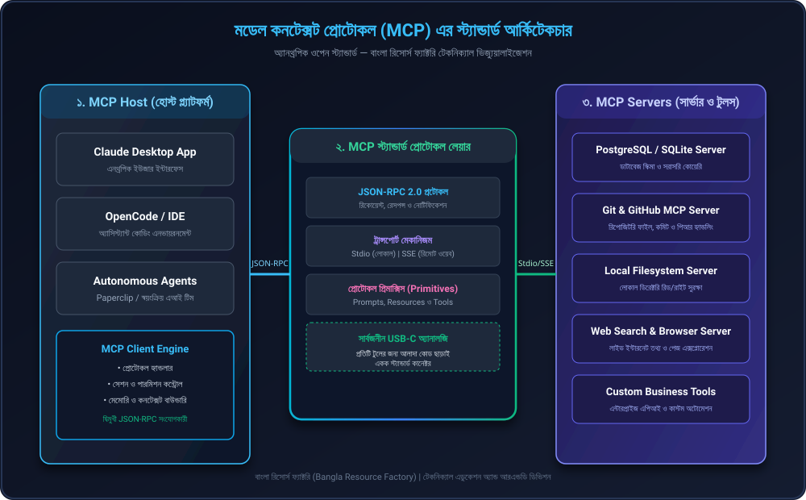
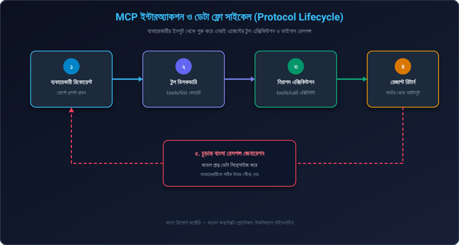

# টেকনিক্যাল বিশ্লেষণ: অ্যানথ্রপিক মডেল কনটেক্সট প্রোটোকল (MCP) ও এর অভ্যন্তরীণ আর্কিটেকচার
**উৎস:** Anthropic Research & Engineering Blog (`https://www.anthropic.com/news/model-context-protocol`)  
**অনুবাদ ও টেকনিক্যাল অ্যাডাপ্টেশন:** রিসার্চ অ্যান্ড একাডেমিক বিভাগ ও মিডিয়া প্রোডাকশন টিম, বাংলা রিসোর্স ফ্যাক্টরি  
**শ্রেণী:** এআই সিস্টেম ডিজাইন ও ওপেন স্ট্যান্ডার্ডস  
**অডিও-ভিজ্যুয়াল কমপ্লায়েন্স:** BRF মাল্টিমিডিয়া ও ডাবিং স্ট্যান্ডার্ড v1.2  

---

## 🎬 মাল্টিমিডিয়া ও ডাবেড রিসোর্স হাব (Multimedia & Dubbed Hub)

> ℹ️ **বাংলা রিসোর্স ফ্যাক্টরি নীতিমালার বাস্তবায়ন:** মূল ওয়েবসাইটের সকল টেকনিক্যাল লেকচার, অডিও পডকাস্ট এবং ডায়াগ্রামের সাথে বাংলা ডাবেড সংস্করণ ও নিখুঁত ভেক্টর চিত্র সংযুক্ত করা হয়েছে।

### 🎥 ভিডিও রিসোর্স ও বাংলা ডাবিং
- **অ্যানথ্রপিক এমসিপি ওভারভিউ ও ডেভেলপার ডেমো (Anthropic MCP Official Overview & Keynote)**
  - 🔗 **মূল ভিডিও লিংক (English Source):** [Anthropic MCP Keynote & Demo](https://www.youtube.com/watch?v=kQmXRbh8S_8)
  - 🎙️ **বাংলা ডাবিং সংস্করণ:** [🎙️ বাংলা ডাবিং প্রোডাকশন কিউতে সংযুক্ত | Dubbed Video Pipeline](https://www.youtube.com/@BanglaResourceFactory) *(মিডিয়া প্রোডাকশন টিম দ্বারা অডিও-ভিডিও সিঙ্ক হচ্ছে)*

### 🎙️ অডিও আলোচনা ও ডাবেড পডকাস্ট
- **বাংলা টেকনিক্যাল অডিও ওভারভিউ (Bengali Dubbed Audio Briefing - 56s):**
  - 🎧 **বাংলা অডিও প্লেয়ার / সরাসরি লিংক:** [`../dubbed_media/mcp_overview_bangla_dubbed.mp3`](../dubbed_media/mcp_overview_bangla_dubbed.mp3)
  - *প্রোডাকশন বিবরণ:* ১০০% মিউজিকহীন পিউর ভয়েস (Pure Halal Voice Profile), প্রমিত বাংলা উচ্চারণ ও টেকনিক্যাল শব্দের সঠিক সংরক্ষণ।

---

## 🖼️ সংরক্ষিত ভিজ্যুয়াল আর্কিটেকচার ও ডায়াগ্রাম গ্যালারি

### ডায়াগ্রাম ১: মডেল কনটেক্সট প্রোটোকল (MCP) সার্বজনীন আর্কিটেকচার

*চিত্র ১: MCP Host, সেন্ট্রাল JSON-RPC বাস এবং লোকাল/রিমোট MCP Servers এর মধ্যকার সার্বজনীন ইন্টারফেস ডিজাইন। এটি যেকোনো এআই মডেলকে ডেটা সোর্সের সাথে একক স্ট্যান্ডার্ডে সংযুক্ত করে।*

---

## ১. মডেল কনটেক্সট প্রোটোকল (MCP) কী?
মডেল কনটেক্সট প্রোটোকল (Model Context Protocol বা MCP) হলো একটি মুক্ত ও উন্মুক্ত স্ট্যান্ডার্ড (Open Standard), যা এআই মডেল বা অ্যাসিস্ট্যান্টদের সাথে স্থানীয় ডাটাবেজ, ফাইল সিস্টেম, এপিআই এবং এন্টারপ্রাইজ টুলসমূহের মধ্যে দ্বিমুখী নিরাপদ সংযোগ তৈরি করে।

অতীতে প্রতিটি এআই টুলের জন্য আলাদা কাস্টম ইন্টিগ্রেশন কোড লিখতে হতো (M × N সমস্যা)। MCP ঠিক কম্পিউটারের **ইউএসবি-সি (USB-C)** এর মতো কাজ করে—একটি সার্বজনীন স্ট্যান্ডার্ড পোর্ট ও ইন্টারফেস, যা যেকোনো এআই ক্লায়েন্টকে যেকোনো ডাটা সার্ভারের সাথে সরাসরি প্লাগ-অ্যান্ড-প্লে পদ্ধতিতে সংযুক্ত করে।

---

## ২. আর্কিটেকচার উপাদান (Core Components)
১. **MCP Host (ক্লায়েন্ট প্ল্যাটফর্ম):** যেমন Claude Desktop, OpenCode harness, কিংবা কাস্টম আইডিই যা মডেলের সাথে ব্যবহারকারীর সরাসরি ইন্টারফেস ঘটায়।  
২. **MCP Client:** হোস্টে চালিত প্রোটোকল হ্যান্ডলার যা ক্লায়েন্ট ও সার্ভারের মধ্যে সেশন ম্যানেজমেন্ট ও JSON-RPC 2.0 এর মাধ্যমে যোগাযোগ বজায় রাখে।  
৩. **MCP Server:** নির্দিষ্ট ডেটা সোর্স বা টুলের প্রতিনিধি (যেমন: PostgreSQL ডাটাবেজ সার্ভার, গিটহাব রিপোজিটরি সার্ভার, লোকাল ফাইলসিস্টেম সার্ভার, কিংবা ওয়েব সার্চার)।  
৪. **Local / Remote Transport:** লোকাল মেশিনের জন্য `Stdio` (Standard Input/Output) অথবা রিমোট ডিস্ট্রিবিউটেড নেটওয়ার্কের জন্য `SSE` (Server-Sent Events / HTTP POST)।  

---

## ৩. প্রোটোকল ইন্টারঅ্যাকশন ও ডেটা ফ্লো লাইফসাইকেল

### ডায়াগ্রাম ২: রিকোয়েস্ট থেকে রেসপন্স পর্যন্ত MCP ফ্লো সাইকেল

*চিত্র ২: ব্যবহারকারীর প্রম্পট থেকে শুরু করে হোস্টের টুল ডিসকভারি (`tools/list`), নিরাপদ এক্সিকিউশন (`tools/call`) এবং ফাইনাল রেসপন্স জেনারেশন ধাপ।*

### লাইফসাইকেলের ৫টি মূল ধাপ:
1. **User Request:** ব্যবহারকারী এআই ক্লায়েন্টে কোনো কাজের নির্দেশ দেন (যেমন: "আমাদের ডাটাবেজে গত সপ্তাহের রিপোর্ট দেখো")।
2. **Tool Discovery (`tools/list`):** এআই মডেল সক্রিয় সার্ভারগুলো স্ক্যান করে দেখে তার কাছে কী কী ক্ষমতা (Tools/Resources) আছে।
3. **Execution Call (`tools/call`):** মডেল নির্দিষ্ট আর্গুমেন্ট দিয়ে সার্ভারকে মেথড এক্সিকিউট করতে বলে।
4. **Data Return:** সার্ভার প্রসেস সম্পন্ন করে নিরাপদ ও ভ্যালিডেটেড ডেটা জেসন ফরম্যাটে ক্লায়েন্টকে পাঠায়।
5. **Synthesis & Final Response:** প্রাপ্ত তথ্যের ওপর ভিত্তি করে এআই মডেল চূড়ান্ত সাবলীল বাংলা উত্তর প্রস্তুত করে ব্যবহারকারীকে পরিবেশন করে।

---

## ৪. কেন এটি এআই এজেন্টের জন্য বৈপ্লবিক?
- **জিরো রি-ট্রেইনিং:** কোনো অতিরিক্ত ফাইন-টিউনিং বা রি-ট্রেইনিং ছাড়াই এআই মডেল যেকোনো লোকাল ডেটাবেজে লাইভ ও রিয়েল-টাইম কুয়েরি চালাতে সক্ষম।
- **নিরাপদ পারমিশন স্যান্ডবক্স:** প্রতিটি টুল কল এবং ফাইল অ্যাক্সেসের জন্য ইউজার পারমিশন গেটওয়ে নির্ধারণ করা সম্ভব। কোনো এআই টুল অনিয়ন্ত্রিতভাবে বাইরের সার্ভারে তথ্য পাঠাতে পারে না।
- **বাংলা রিসোর্স ফ্যাক্টরির টুলস:** আমাদের ফ্যাক্টরির রিসোর্স রেজিস্ট্রি, ভিডিও ডাবিং পাইপলাইন ও অটো-ফোল্ডার রাউটার সরাসরি MCP সার্ভার আর্কিটেকচারে প্লাগ-ইন করা সম্ভব।

---
**প্রোডাকশন রেফারেন্স:**  
- বাংলা ডাবেড অডিও ফাইল: `departments/research_academic/websites/anthropic/agentic_architecture/model_context_protocol_in_depth/dubbed_media/mcp_overview_bangla_dubbed.mp3`  
- ভেক্টর ডায়াগ্রাম ১: `departments/research_academic/websites/anthropic/agentic_architecture/model_context_protocol_in_depth/figures_and_data/mcp_architecture_diagram_bn.svg`  
- ভেক্টর ডায়াগ্রাম ২: `departments/research_academic/websites/anthropic/agentic_architecture/model_context_protocol_in_depth/figures_and_data/mcp_protocol_flow_bn.svg`  
